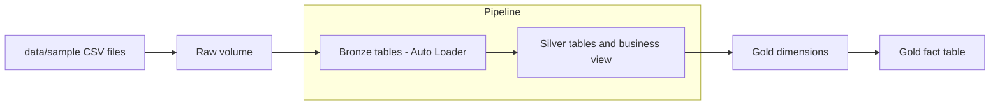

# AirLake

Databricks Asset Bundle for a medallion architecture data pipeline

## Requirements

- Databricks workspace with Unity Catalog enabled.
- Databricks CLI installed and authenticated.
- Permission to create and write to the configured catalog, schemas, and volumes.
- Sample files in `data/sample`.
- A Unix-style shell with `make` (Linux or macOS terminal; on Windows use Git Bash or WSL).

## Configure

Set workspace/catalog-specific values in `databricks.yml`. The bundle passes them to the
setup job, the pipeline, and the gold job.

## Deploy

From the project root:

```powershell
databricks bundle validate -t dev
databricks bundle deploy -t dev
```

Run the deployed resources in this order:

1. `AirLake-dev-setup` creates schemas, volumes, and raw-data folders.
2. `AirLake-dev-load-sample` copies sample CSVs (deployed with the bundle) into the raw
   folders. Parameter `dataset`: `initial` (default), `incremental` or `scd`.
3. `AirLake-dev-pipeline` ingests the raw CSVs into bronze tables with Auto Loader, then
   builds the silver tables and the business view.
4. `AirLake-dev-gold-dimensions` updates gold dimensions, then the fact table.

The jobs use serverless compute. Databricks Free Edition may limit concurrent or
active serverless runs; stop unused jobs and pipeline updates before retrying.

## Quick start with make

```text
make all          # deploy, setup, load initial data, run bronze -> silver -> gold
make incremental  # load incremental files and rerun the pipeline
make scd          # load SCD change files and rerun the pipeline
make run          # rerun the pipeline only
make full-refresh # rebuild all pipeline tables from scratch, then gold
```

## Data Flow



## Layout

```text
databricks.yml       Bundle variables and targets
resources/           Jobs and pipeline definitions
src/notebooks/       Setup, sample-load, and gold notebooks
src/Pipelines/       Pipeline source: bronze ingestion, silver tables and views
data/sample/<dataset>/<table>/   Sample CSVs (initial, incremental, scd), mirrors raw volume
```
