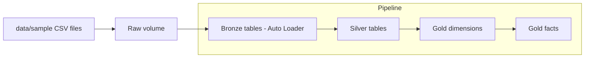

# Air Lake

An airline lakehouse on Databricks: bronze → silver → gold in one declarative pipeline.

- **Bronze:** Auto Loader ingests raw CSV files incrementally.
- **Silver:** config-driven cleaning and validation (`config/sources.yml`). AUTO CDC keeps SCD1 or
  SCD2 history, and rows that break a rule go to a `<table>_quarantine` table.
- **Gold:** a Kimball star schema as materialized views, with transaction, accumulating snapshot,
  periodic snapshot, factless and aggregate fact tables.
- **Data quality:** pipeline expectations count rows that break a rule or miss a dimension.

The sample data is generated and shaped like an airline's operational system.

## Architecture



## Data model

- Source tables: [docs/source_schema.md](docs/source_schema.md)
- Gold star schema: [docs/gold_schema.md](docs/gold_schema.md)

## Quick start

You need a Databricks workspace with Unity Catalog, the Databricks CLI (authenticated), and `make`
(on Windows use Git Bash or WSL).

```bash
uv run python -m zipfile -e data/sample_.zip data/   # unzip the sample data (PowerShell: Expand-Archive)
make all           # deploy, set up, load the initial data, run bronze -> silver -> gold
make incremental   # load the next batch and rerun the pipeline
make scd           # load SCD changes and rerun the pipeline
```

`make run` reruns the pipeline only, and `make full-refresh` rebuilds every table from scratch.

<details>
<summary>Step by step without make</summary>

Set the catalog and schema names in `databricks.yml`, then from the project root:

```bash
databricks bundle validate -t dev
databricks bundle deploy -t dev
```

Run the deployed resources in this order:

1. `AirLake-dev-setup` creates the schemas and the raw volume.
2. `AirLake-dev-load-sample` copies the sample CSVs into the raw volume. Parameter `dataset`:
   `initial` (default), `incremental` or `scd`.
3. `AirLake-dev-pipeline` builds bronze, silver and gold.

Everything runs on serverless compute. Databricks Free Edition limits concurrent serverless runs,
so stop unused jobs and pipeline updates before retrying.

</details>

## Project layout

```text
config/sources.yml   Source tables, keys and silver rules
databricks.yml       Bundle variables and targets
resources/           Jobs and pipeline definitions
src/Pipelines/       Pipeline source: bronze, silver, gold
src/notebooks/       Setup and sample-load notebooks
data/sample_.zip     Sample data; unzips to data/sample/<dataset>/<table>/
docs/                Source and gold schema
```

## License

[MIT](LICENSE)
