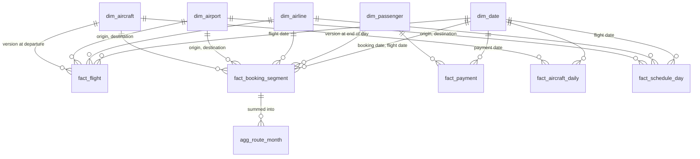

# Gold schema

Gold is a Kimball star schema, built as materialized views in the pipeline
(`src/Pipelines/gold_tables/dims.py` and `facts.py`).

- **Surrogate keys** are `xxhash64` of the natural key (plus `valid_from` for SCD2), so they stay
  the same on every refresh. Date keys are `yyyyMMdd` integers.
- **Unknown member:** every dimension has a row with key `-1`. A fact row points there when its
  lookup finds nothing, for example bookings for the missing passenger `PX999999`.
  Pipeline expectations count those rows.

## Facts

| Table | Type | One row is | Measures |
|---|---|---|---|
| `fact_booking_segment` | Transaction | one passenger on one flight | `fare_amount` |
| `fact_payment` | Transaction | one payment or refund | `amount` (refunds negative) |
| `fact_flight` | Accumulating snapshot | one flight, updated as it departs and arrives | delay minutes, `is_cancelled` |
| `fact_aircraft_daily` | Periodic snapshot | one aircraft on one day | `is_active`, `active_seats` (sum across aircraft, not days) |
| `fact_schedule_day` | Factless (coverage) | one scheduled departure on one day | none |
| `agg_route_month` | Aggregate | one route in one month | `seats_sold`, `revenue` |

## Dimensions

| Table | Type | Notes |
|---|---|---|
| `dim_date` | Generated | First to last date in the data |
| `dim_airline` | SCD1 | |
| `dim_airport` | SCD1 | Used twice: origin and destination |
| `dim_aircraft` | SCD2 | `valid_from` / `valid_to`; the first version starts 1900-01-01 |
| `dim_passenger` | SCD1 | No names, email or phone (GDPR); only nationality and birth year |
