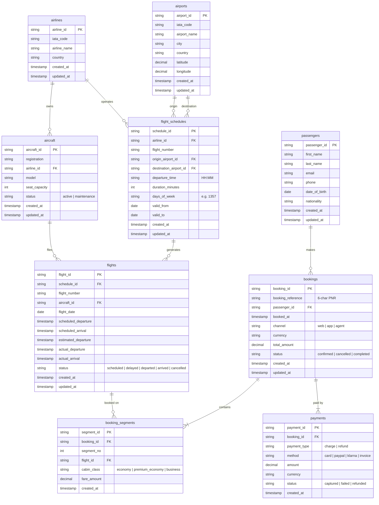

# Source schema

The generated sample data imitates extracts from an airline's operational system.
These are the source tables as they land in bronze, before any modelling.

## Two kinds of tables

| Kind | Tables | How rows change |
|---|---|---|
| Mutable entities | airlines, airports, aircraft, flight_schedules, flights, passengers, bookings | Updated in place; `updated_at` says which version is newest |
| Insert-only events | booking_segments, payments | Never updated; a refund is a new payment row |

## Batches

| Batch | Contents |
|---|---|
| `initial` | Current state of every row as of 2026-06-01 |
| `incremental` | Every version of every row changed 2026-06-01 → 2026-07-01, unordered |
| `scd` | Every version changed 2026-07-01 → 2026-08-01, plus some older versions replayed late |
| `dirty` | Rows that should fail quality checks: null keys, orphan FKs, bad values, duplicates |
